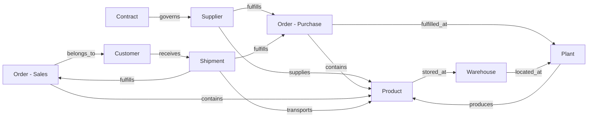
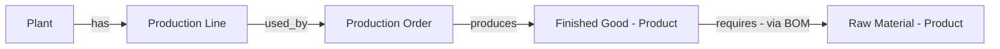

# Canonical Supply-Chain Ontology — Diagram

## Core ontology + relationships



## Manufacturing extension (layered on core, no core redesign)



## Full dependency chain used for impact analysis

```
Supplier --> Product (raw material) --> Bill of Materials --> Finished Good
   --> Plant / Production Line --> Production Order
   --> Sales Order --> Shipment --> Customer
```

Traversal is bidirectional over `ONTOLOGY_GRAPH.RELATIONSHIP_EDGES`
(see `EDGES_FORWARD` / `EDGES_BACKWARD` / `EDGES_BIDIRECTIONAL` views), so
both of these queries are one join away:
- **Forward:** "What customers depend on Supplier ABC?"
- **Backward:** "Which suppliers are responsible for delayed Customer XYZ orders?"

## Adaptive modules

| Module | Status | Entities |
|---|---|---|
| **Core** | Always on | Supplier, Customer, Product, Plant, Location, Order, Order Line, Contract, Transaction |
| **Goods** | Populated from ERP A + ERP B | Warehouse, Inventory |
| **Manufacturing** (industry extension) | Populated with net-new synthetic data | Production Line, Bill of Materials, Production Order |
| **Services** | Populated with a small standalone demo dataset | Service Provider, Service, Service Order, Milestone |

Each module lives in its own Snowflake schema
(`ONTOLOGY_CORE`, `ONTOLOGY_GOODS`, `ONTOLOGY_MANUFACTURING`,
`ONTOLOGY_SERVICES`) and only references CORE entities by canonical ID —
none of them modify CORE tables. A future industry module (e.g. Retail,
Pharma) would follow the same pattern: its own schema, its own tables,
foreign keys back to `ONTOLOGY_CORE`.
